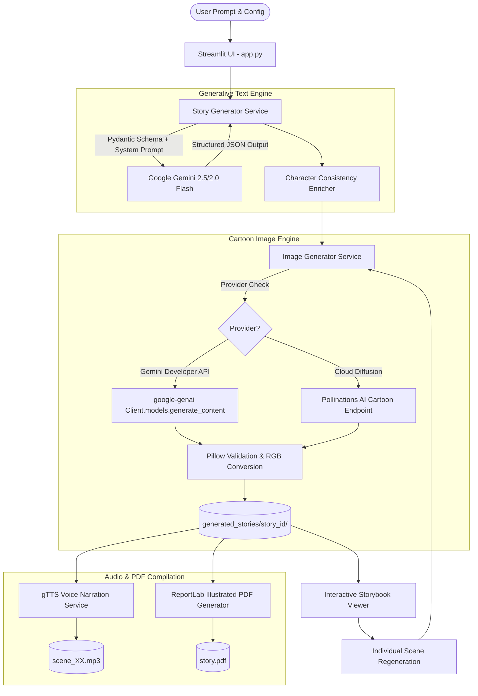

# ToonTales AI - Generative AI-Powered Cartoon Storytelling Platform

[](https://www.python.org/)
[](https://streamlit.io/)
[](https://pypi.org/project/google-genai/)
[]()
[]()

> **ToonTales AI** is an end-to-end Generative AI platform that transforms arbitrary story ideas into interactive, illustrated cartoon storybooks. Designed for children, parents, and educators, it pairs large language models (LLMs) with multimodal image diffusion models to generate original narratives, divide them into episodic scenes, enforce persistent character designs, synthesize cartoon illustrations, provide voice narration, and export downloadable illustrated PDFs.

---

## 1. Problem Statement & Objectives

### 1.1 Problem Statement
Traditional digital storytelling tools either rely on pre-rendered, static assets or lack coherent multimodal orchestration. While generative AI models can generate text and standalone images, naive implementations face three critical shortcomings:
1. **Lack of Visual Continuity:** Characters change species, hair, costumes, and color palettes across scenes.
2. **Unstructured Output Failure:** Text models generate raw prose without the structured metadata needed for programmatic scene splitting, prompt injection, and layout formatting.
3. **Single Point of Failure in Multimodal Pipelines:** If an image generation API rate-limits or fails, entire pipelines often collapse without saving intermediate progress.

### 1.2 Objectives
* **Autonomous Story Generation:** Synthesize original stories across arbitrary genres, age groups, lengths, and art styles from natural language user prompts.
* **Character Consistency System:** Maintain distinct visual signatures (species, costume, body shape, markings) across all scene illustrations.
* **Dual-Provider Cartoon Image Generation:** Support Google Gemini Developer API multimodal image generation (`gemini-2.5-flash-image` via `generate_content`) with an accessible zero-cost cloud diffusion fallback option.
* **Single-Scene Regeneration:** Enable users to re-roll individual scene illustrations without re-generating the story or affecting other scenes.
* **Automated PDF Storybook Publishing:** Dynamically format and typeset multi-page illustrated PDFs with cover pages, metadata, and running page counts using ReportLab.
* **Failsafe Audio Narration:** Synthesize scene-by-scene audio narration using text-to-speech.

---

## 2. Technology Stack

| Layer | Technology | Version | Purpose |
| :--- | :--- | :--- | :--- |
| **Frontend & UI** | Streamlit | `>= 1.40.0` | Interactive web UI, reactive session state, widgets |
| **Custom Styling** | Vanilla CSS3 & Google Fonts | Modern | Child-friendly aesthetics, soft pastels, responsive cards |
| **Generative AI (Text)** | Google Gemini API (`google-genai` SDK) | `2.25.0` | Structured JSON generation, story narrative, scene division |
| **Generative AI (Images)** | Gemini Developer API & Pollinations Diffusion | Configurable | Cartoon illustration synthesis |
| **Image Processing** | Pillow (PIL) | `>= 10.0.0` | Image verification, color-space conversion, atomic file saving |
| **Document Typesetting** | ReportLab Platypus | `>= 4.0.0` | Illustrated storybook PDF generation with NumberedCanvas |
| **Voice Synthesis** | gTTS | `>= 2.5.0` | Scene narration audio generation |
| **Data Validation** | Pydantic v2 | `>= 2.0.0` | Strict JSON schema definition and runtime validation |
| **Environment Config** | python-dotenv | `>= 1.0.0` | Safe API credential loading from `.env` |
| **Automated Testing** | Pytest & Unittest Mock | `>= 8.0.0` | Unit and integration test suite |

---

## 3. System Architecture & Workflow



---

## 4. Key Features

1. **Structured Story Synthesis:**
   - Enforces Pydantic schema validation: title, summary, genre, art style, character roster, and sequential scenes.
   - Division into 5, 6, or 8 distinct scenes with headings, narration, environment settings, and camera prompts.
2. **Persistent Character Visuals:**
   - Every character is registered with physical appearance, clothing, colors, and distinctive accessories.
   - Visual profiles are automatically prepended into scene image prompts to maintain visual identity across illustrations.
3. **5 Supported Cartoon Art Styles:**
   - *Colorful 2D Cartoon*
   - *Storybook Illustration*
   - *Anime-Inspired Illustration*
   - *Watercolor Illustration*
   - *3D Animated-Film-Inspired Illustration*
4. **Interactive Storybook Navigation:**
   - Sequential navigation (Previous / Next) with progress counter ("Scene 2 of 5").
   - Quick jump carousel to switch directly to any scene.
   - Built with Streamlit session state: navigating scenes **never** triggers re-generation.
5. **Single-Scene Regeneration:**
   - Re-roll individual scene illustrations on demand.
   - Preserves text, character profiles, other scene images, and atomically updates the PDF.
6. **Downloadable Illustrated PDF:**
   - Formatted with cover page, summary callout box, character profiles, illustrated scene pages, and a two-pass running footer (`Page X of Y`).
7. **Voice Narration:**
   - Built-in audio playback for scene narration. Completely non-blocking and failsafe.
8. **Interactive Demo Storybook:**
   - Pre-packaged sample storybook (*Ruby and the Moonbeam Lantern*) for immediate evaluation without requiring an API key on first launch.

---

## 5. Project Folder Structure

```
ToonTales AI/
│
├── app.py                      # Main Streamlit web application & UI
├── requirements.txt            # Python dependencies
├── .env.example                # Configuration template
├── .gitignore                  # Git exclusions (credentials, outputs)
├── README.md                   # Comprehensive project documentation
│
├── services/                   # Core business logic services
│   ├── __init__.py
│   ├── story_generator.py      # Gemini text generation & character enrichment
│   ├── image_generator.py      # Imagen 3 & cloud diffusion image generation
│   ├── pdf_generator.py        # ReportLab illustrated PDF compilation
│   └── narration.py            # Text-to-speech audio narration
│
├── utils/                      # Helper utilities
│   ├── __init__.py
│   ├── helpers.py              # File sanitization, workspace, config & Pillow checks
│   └── generate_demo.py        # Standalone demo storybook generator
│
├── assets/                     # Visual assets and styling badges
│   └── .gitkeep
│
├── generated_stories/          # Persisted story directories
│   ├── .gitkeep
│   └── demo_story/             # Pre-generated sample storybook
│       ├── story.json          # Story metadata & scene data
│       ├── scene_01.png        # Generated cartoon illustration
│       ├── scene_01.mp3        # Generated voice narration
│       └── story.pdf           # Generated illustrated PDF storybook
│
└── tests/                      # Automated test suite
    ├── __init__.py
    ├── test_story_generator.py # JSON schema, character enrichment & Gemini mocks
    ├── test_image_generator.py # Prompt builder, image bytes, Pillow validation & mocks
    └── test_pdf_generator.py   # PDF compilation & missing-image resilience tests
```

---

## 6. Installation & Setup

### 6.1 Prerequisites
- Python 3.10, 3.11, or 3.12 installed on your system.
- Git (optional, for cloning).

### 6.2 Clone or Navigate to the Project Directory
```bash
cd "d:\MCA notes\GEN-AI"
```

### 6.3 Create and Activate a Virtual Environment (Recommended)
**On Windows (PowerShell):**
```powershell
python -m venv venv
.\venv\Scripts\Activate.ps1
```

**On Linux / macOS:**
```bash
python3 -m venv venv
source venv/bin/activate
```

### 6.4 Install Dependencies
```bash
pip install -r requirements.txt
```

---

## 7. API Configuration & Security

### 7.1 Obtaining a Google Gemini API Key
1. Visit [Google AI Studio](https://aistudio.google.com/).
2. Sign in with your Google account.
3. Click **"Get API key"** and create a key in a new or existing Google Cloud project.
4. Copy the API key.

### 7.2 Configuring `.env`
Copy `.env.example` to `.env`:
```bash
copy .env.example .env
```

Edit `.env` with your settings:
```ini
# Google Gemini API Key (Required for story text generation)
GEMINI_API_KEY=AIzaSy...your_actual_key_here

# Gemini Text Model for Story Generation
GEMINI_TEXT_MODEL=gemini-2.5-flash

# Image Generation Provider: 'pollinations' (Recommended - No billing required) or 'gemini'
IMAGE_PROVIDER=pollinations

# Pollinations AI Model (flux is recommended for cartoon artwork)
POLLINATIONS_IMAGE_MODEL=flux
# Optional: Secret key from enter.pollinations.ai/keys (leave blank for zero-cost public tier)
# POLLINATIONS_API_KEY=your_optional_pollinations_key_here

# Gemini Multimodal Image Generation Model (Requires Pay-As-You-Go Google Cloud billing)
GEMINI_IMAGE_MODEL=gemini-2.5-flash-image
```

> **Security Note:** `.env` is included in `.gitignore`. Never commit API keys to version control. Keys can also be entered directly in the web UI sidebar for testing.

---

## 8. Running the Application

Launch the Streamlit web application:
```bash
python -m streamlit run app.py
```

The application will open in your default browser at:
`http://localhost:8501`

---

## 9. Automated Testing

ToonTales AI includes a comprehensive test suite using `pytest` with mocked API endpoints.

Run the test suite:
```bash
python -m pytest tests/ -v
```

Expected output:
```
============================= test session starts =============================
platform win32 -- Python 3.11.0, pytest-9.1.1
collected 27 items

tests/test_image_generator.py .....................                     [ 77%]
tests/test_pdf_generator.py ..                                          [ 85%]
tests/test_story_generator.py ....                                      [100%]

============================= 27 passed in 7.86s ==============================
```

---

## 10. Generative AI Academic Concepts Explained

As part of this MCA Generative AI curriculum project, the application demonstrates key theoretical and practical concepts:

### 10.1 Large Language Models (LLMs) & System Prompting
The platform utilizes Gemini 2.5 Flash as a generative backbone. Rather than allowing unbounded free-form text, the model is constrained by detailed system instructions defining narrative arcs, child-appropriate language constraints, and scene division rules.

### 10.2 Structured JSON Generation
Modern generative applications require predictable interfaces. By employing Pydantic schemas in tandem with Gemini's `response_mime_type="application/json"`, the LLM generates machine-readable data structures that directly drive downstream processes (Pillow rendering, PDF generation, UI widgets) without brittle regex parsing.

### 10.3 Character Consistency Engineering
Text-to-image models lack persistent memory across distinct generation calls. To maintain character continuity, ToonTales AI extracts an explicit visual signature for each character (e.g., *Ruby: small white rabbit, purple astronaut suit, silver helmet, star badge*) and dynamically synthesizes these tokens into the image prompt of every scene in which the character appears.

### 10.4 Multimodal Orchestration
The platform exemplifies compound AI workflows:
1. **Unimodal Text:** Idea $\rightarrow$ Story & Scenes (Gemini).
2. **Text-to-Image:** Prompt $\rightarrow$ Cartoon Illustration (Imagen 3 / Diffusion).
3. **Text-to-Speech:** Narration text $\rightarrow$ Audio waveform (gTTS).
4. **Document Typesetting:** Aggregation of multimodal artifacts into a cohesive PDF storybook (ReportLab).

---

## 11. Cost & Quota Considerations

- **Text Model:** `gemini-2.5-flash` provides fast, cost-effective story narrative generation with generous free-tier quotas.
- **Image Generation Quota:** 
  - Google Gemini native image models (e.g. `gemini-2.5-flash-image`) have **0 free-tier requests** on unbilled Google AI Studio projects (`Free-tier requests per minute: 0, Free-tier requests per day: 0`). Generating images with the Gemini API requires enabling Pay-As-You-Go billing in Google AI Studio / Google Cloud.
  - **Zero-Cost Fallback:** ToonTales AI includes a high-quality cloud diffusion provider (`IMAGE_PROVIDER=pollinations`) that generates full cartoon illustrations without requiring billing or extra API keys. Note that anonymous public IP rate limits apply (1 request / 45s), which ToonTales AI automatically detects with informative retry countdowns.
- **Circuit Breaker:** If a zero-quota error is detected on the first scene, the pipeline stops making repeated requests to avoid hammering exhausted endpoints.
- **Atomic Operations:** Illustrations are verified with Pillow before destination replacement, ensuring previously generated images are preserved if an individual regeneration fails.

---

## 12. Troubleshooting

| Issue | Cause | Solution |
| :--- | :--- | :--- |
| `Gemini API Key is missing` | `.env` not loaded or key not entered | Add `GEMINI_API_KEY` to `.env` or input it in the sidebar. |
| `Quota Exceeded: Free-tier requests: 0` | Google AI Studio free tier has 0 quota for image models | Enable Pay-As-You-Go billing on your Google Cloud project, or select **Pollinations AI** in the sidebar. |
| `Rate limit reached (45s)` | Multiple rapid requests on free tier | Wait 45 seconds and click *Regenerate Illustration* on the scene. |
| Streamlit port busy | Port 8501 already occupied | Run `python -m streamlit run app.py --server.port 8502`. |

---

## 13. License & Academic Attribution
Developed as an MCA Academic Project in Generative Artificial Intelligence.
Available for academic and educational evaluation.
